# Domus: manual de usuario

**Versión:** 1.0, octubre de 2026
**Para quién es:** vecinos, administradores de consorcios y el superadministrador de la plataforma
**Estructura:** ISO/IEC/IEEE 26514:2022, con el contenido organizado según Diátaxis: tutoriales para aprender, guías para resolver una tarea, referencia para consultar y explicaciones para entender.

## Contenido

| Sección | Para quién | Tipo |
|---|---|---|
| 1. Antes de empezar | Todos | Referencia |
| 2. Tu primer ingreso y tu boleta del mes | Vecino | Tutorial |
| 3. Guías del vecino | Vecino | Guías |
| 4. Tu primera liquidación | Administrador | Tutorial |
| 5. Guías del administrador | Administrador | Guías |
| 6. Guías del superadministrador | Superadministrador | Guías |
| 7. Estados y qué significan | Todos | Referencia |
| 8. Cómo funciona | Vecino y administrador | Explicación |
| 9. Mensajes de error frecuentes y qué hacer | Todos | Referencia |
| 10. Preguntas frecuentes y soporte | Todos | Referencia |

## 1. Antes de empezar

**Qué necesitás:** un navegador actualizado (Chrome, Edge, Firefox o Safari), en la computadora o en el celular. No hay que instalar nada.

**Tu cuenta:** no hay registro abierto. Al vecino lo da de alta la administración de su edificio, con una contraseña inicial que conviene cambiar desde Perfil. Al administrador lo da de alta el superadministrador.

**Cómo ingresar:** entrá a la dirección de Domus, escribí tu email y tu contraseña y tocá **Ingresar**. Cada rol entra a su portal:

- el vecino, a su **Inicio**;
- el administrador, al **Panel general**;
- el superadministrador, al panel de la **Plataforma**.

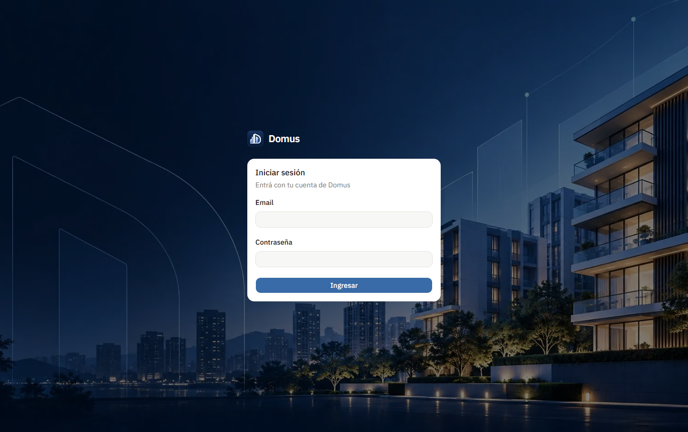

## 2. Tu primer ingreso y tu boleta del mes (tutorial para el vecino)

**Antes de empezar:** Tu cuenta, vinculada a una unidad que tenga una boleta emitida con saldo.

En cinco minutos vas a ver lo que debés, pagarlo y descargar el recibo.

1. **Ingresá** con el email y la contraseña que te dio la administración.
2. En **Inicio** mirá la tarjeta de expensas: muestra la boleta del mes, el saldo y cuántos días faltan para el vencimiento.
   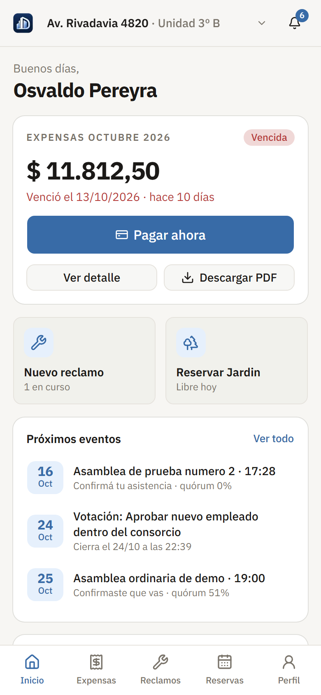
3. Tocá **Pagar ahora**. Vas a ver el detalle de lo que pagás: expensas, fondo de reserva, saldo anterior e intereses, si los hay.
4. Tocá **Pagar** y completá el pago en Mercado Pago.
5. Al terminar, tocá **Volver al sitio**. Domus te muestra **Pago aprobado**, con el número de recibo.
   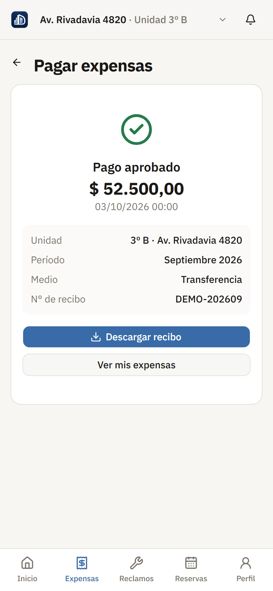
6. Tocá **Descargar recibo** para guardarlo. También te llega por mail el aviso de pago recibido.
7. Por último, entrá a **Perfil** y cambiá la contraseña inicial por una tuya.

## 3. Guías del vecino

### 3.1 Cómo pagar las expensas con Mercado Pago

**Antes de empezar:** Una boleta emitida con saldo en tu unidad.

1. Andá a **Expensas** y tocá **Pagar** en la boleta vigente.
2. Revisá el detalle y tocá **Pagar** para ir a Mercado Pago.
3. Pagá con tarjeta, dinero en cuenta o efectivo.
4. Tocá **Volver al sitio** para ver el resultado.

Sólo se puede pagar la boleta más reciente de tu unidad: incluye la deuda de las anteriores. Si el pago queda **en proceso** (pasa con efectivo o transferencia), te avisamos cuando se acredite.

### 3.2 Cómo ver tu historial y descargar una boleta

**Antes de empezar:** Al menos una boleta emitida en tu unidad.

1. Andá a **Expensas**: arriba ves el saldo de tu unidad y abajo la historia de boletas agrupada por año.
2. Tocá una boleta para ver los gastos agrupados por rubro, los pagos y sus recibos.
3. Tocá **Descargar boleta** para bajar el PDF, o **Descargar estado de cuenta** desde la lista.

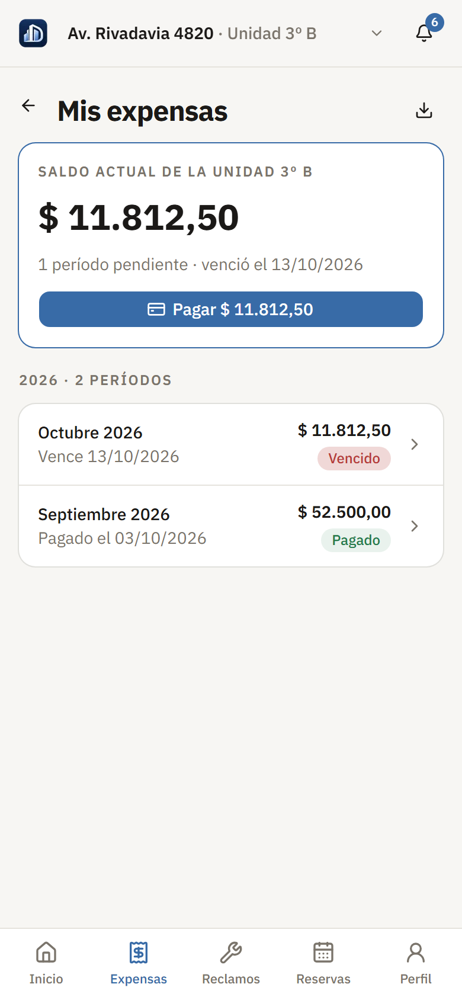

### 3.3 Cómo abrir un reclamo con fotos y seguirlo

**Antes de empezar:** Estar vinculado a una unidad. Las categorías las define la administración.

1. Andá a **Reclamos** y tocá **Nuevo reclamo**.
2. Completá **Título**, **Categoría** y **Descripción**, y sumá hasta 5 fotos.
3. Tocá **Enviar reclamo**. Te llega un mail con el número de reclamo.
4. En **Reclamos** seguís el estado y la conversación con la administración. Cada cambio te llega como aviso.
5. Para responder, abrí el reclamo, escribí tu mensaje y tocá **Enviar**. Un reclamo resuelto no acepta mensajes hasta que la administración lo reabre.

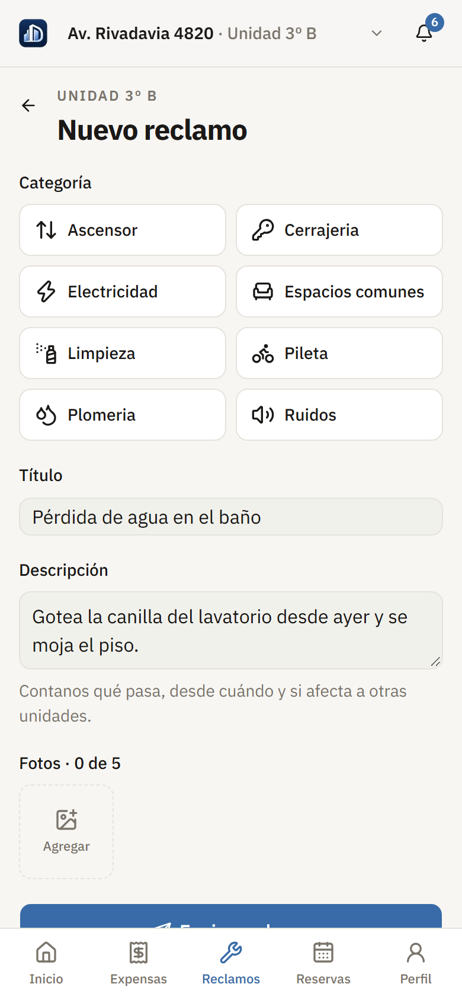

### 3.4 Cómo reservar un amenity y pagar la seña

**Antes de empezar:** Que la administración haya cargado el amenity y que tenga horarios libres. Si el amenity bloquea por deuda, tu unidad no puede tener expensas vencidas.

1. Andá a **Reservas** y tocá **Reservar**.
2. Elegí el amenity, el día y el horario libre.
3. Confirmá. Si el amenity requiere aprobación, la reserva queda pendiente hasta que la administración la apruebe.
4. Si el amenity cobra seña, tocá **Pagar seña** para pagarla con Mercado Pago.
5. Para cancelar, tocá **Cancelar reserva** dentro del plazo que indica el amenity.

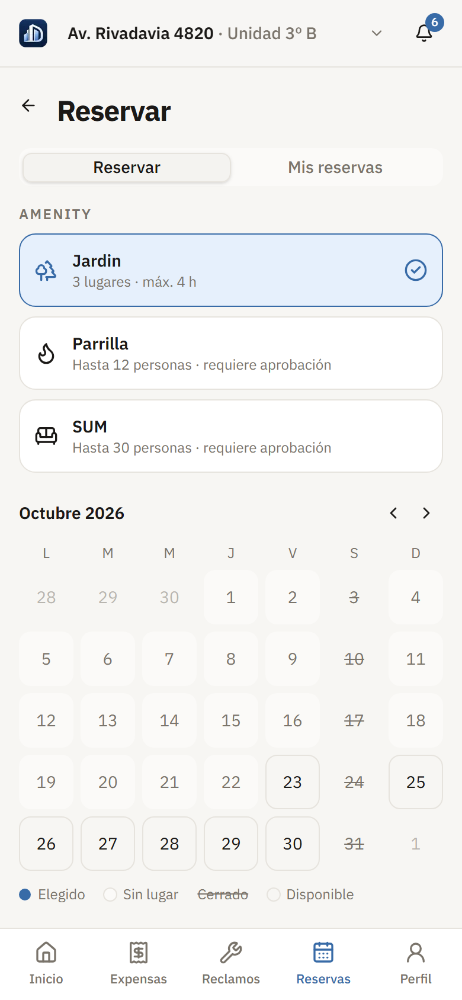

### 3.5 Cómo confirmar asistencia a una asamblea y votar

**Antes de empezar:** Una asamblea convocada o una votación publicada en tu consorcio, y que tu unidad esté en el padrón.

1. Las asambleas convocadas y las votaciones abiertas aparecen en **Inicio**, en los próximos eventos. Tocá una para abrirla.
2. En la asamblea, usá **Confirmá tu asistencia** para avisar si vas a ir.
3. En una votación abierta, tocá **Votar**, elegí una opción y confirmá. Cada unidad vota una sola vez.

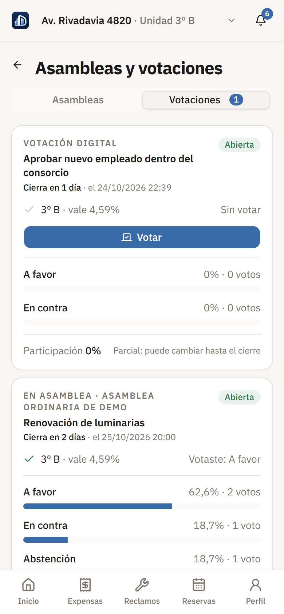

### 3.6 Cómo elegir qué avisos recibir

1. Andá a **Perfil**.
2. En las preferencias de aviso, apagá las categorías que no quieras recibir por mail.
3. En la misma pantalla podés cambiar tu foto, tu teléfono y tu contraseña.

### 3.7 Cómo usar la campana de notificaciones

La campana muestra cuántos avisos tenés sin leer. Tocá uno para ir a su pantalla; queda marcado como leído. **Marcar todas como leídas** deja la campana en cero.

### 3.8 Cómo leer las novedades del edificio

1. En **Inicio**, la sección **Novedades del edificio** muestra las últimas. Tocá **Ver muro** para ver todas; también se llega desde **Perfil**, en **Novedades del edificio**.
2. Las novedades fijadas aparecen primero. Pueden traer adjuntos, como un PDF o una foto.
3. Al abrir una novedad queda marcada como leída, y la administración ve cuántos vecinos la leyeron.

## 4. Tu primera liquidación (tutorial para el administrador)

**Antes de empezar:** Un consorcio con sus unidades cargadas, cuyos coeficientes sumen 100 %, y ningún período anterior sin emitir.

Vas a cargar los gastos del mes, revisar las boletas y emitirlas.

1. En el menú, andá a **Liquidación** y tocá **Nueva liquidación**. Elegí el período.
2. Tocá **Agregar gasto** por cada gasto del mes: rubro, descripción, monto y, si lo tenés, el comprobante.
   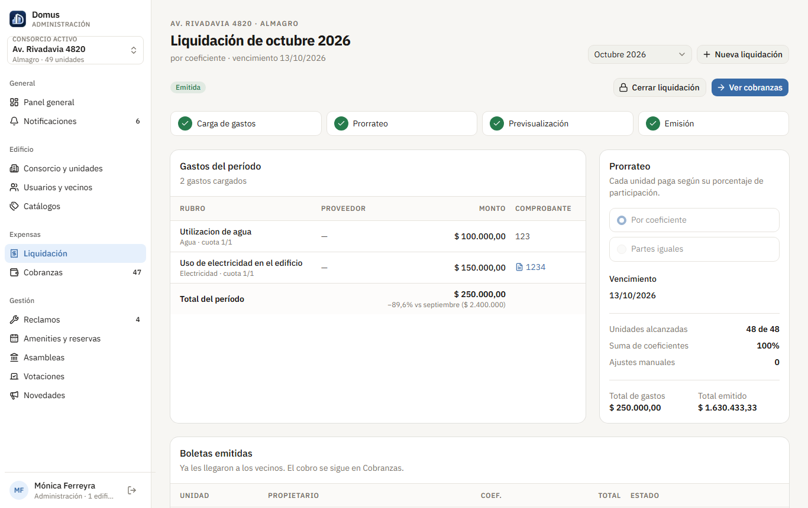
3. Tocá **Continuar a previsualización**. Domus calcula la boleta de cada unidad según su coeficiente.
4. Revisá la previsualización: unidades alcanzadas, suma de coeficientes (tiene que dar 100 %) y la comparación con el mes anterior. Si hace falta, cargá un ajuste en una boleta, con su motivo.
5. Tocá **Emitir boletas**. Las boletas pasan a ser deuda de cada unidad y los vecinos reciben el aviso por mail y en la app.
6. Seguí la cobranza en **Cobranzas**. Cuando termine el período, volvé a la liquidación y tocá **Cerrar liquidación**.

Una liquidación emitida no se puede editar ni borrar. Si hubo un error, se corrige con un ajuste en la liquidación siguiente.

## 5. Guías del administrador

### 5.1 Cómo cargar unidades y vincular vecinos

1. Andá a **Consorcio y unidades** y creá cada unidad con su etiqueta y su coeficiente. Los coeficientes no pueden pasar el 100 %.
2. Tocá **Vecinos** en una unidad y después **Sumar vecino**.
3. Si el vecino no tiene cuenta, cargá sus datos y una contraseña inicial. Si ya tiene, buscalo por su email.
4. Indicá si es propietario o inquilino y si es el titular. Hay un solo titular por unidad.
5. Cuando alguien se muda, terminá su vínculo: deja de ver la unidad en el momento.

### 5.2 Cómo corregir los datos de un vecino o darle una contraseña nueva

**Antes de empezar:** Que el vecino esté vinculado a una unidad de uno de tus consorcios.

1. Andá a **Usuarios y vecinos** y buscalo por nombre, apellido o email. Sólo ves a los vecinos de tus consorcios.
2. En la fila del vecino, usá **Editar datos** para corregir nombre, teléfono o email. Con el email nuevo entra desde la próxima vez; no se puede usar uno que ya tiene otra cuenta.
3. Usá **Nueva contraseña** para asignarle una, por ejemplo si se la olvidó. Conviene que después la cambie desde su Perfil.

Dar de baja una cuenta le corresponde al superadministrador: si un vecino se muda, terminá su vínculo con la unidad (guía 5.1).

### 5.3 Cómo registrar un pago por transferencia

**Antes de empezar:** Una boleta emitida con saldo.

1. Andá a **Cobranzas** y buscá la unidad.
2. Tocá **Registrar pago**, cargá el monto, el medio y la fecha.
3. El pago se registra aprobado y genera su recibo. No se puede cargar más que el saldo de la boleta.

### 5.4 Cómo seguir la cobranza y enviar recordatorios

**Antes de empezar:** Una liquidación emitida.

1. En **Cobranzas** ves lo emitido, lo cobrado, el saldo pendiente y los intereses del período.
2. Filtrá por pendientes, pagados o vencidos, o buscá por unidad o por propietario. Podés exportar la grilla a Excel.
3. Tocá **Enviar recordatorios**: el aviso les llega sólo a quienes todavía tienen saldo.

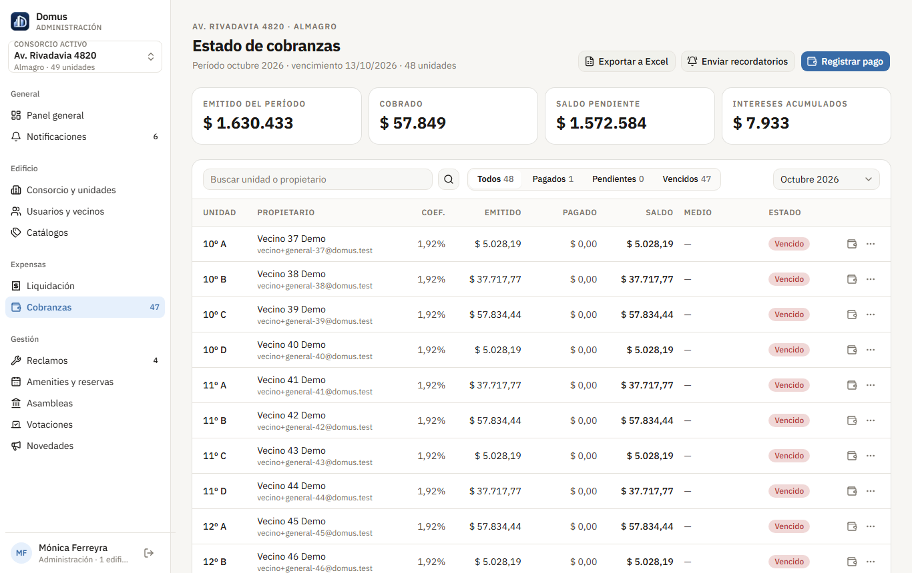

### 5.5 Cómo atender un reclamo

**Antes de empezar:** Un reclamo abierto. Para asignarlo, un proveedor activo en Catálogos.

1. Andá a **Reclamos**. La bandeja se ve como tablero o como lista.
2. Abrí un reclamo y usá las acciones del detalle: **Asignar proveedor**, **Estado**, **Prioridad** y **Marcar resuelto**.
3. Para responderle al vecino, escribí en el detalle. Para dejar algo sólo para la administración, usá **Nota interna**.

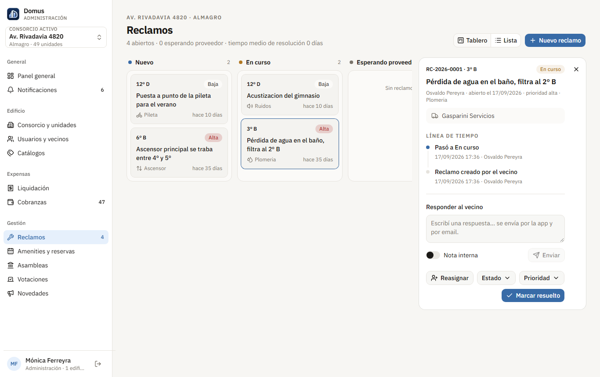

### 5.6 Cómo administrar amenities y reservas

1. Andá a **Amenities y reservas** y tocá **Nuevo amenity**: horario por día, turnos, capacidad, seña, aprobación y plazo de cancelación.
2. En el calendario semanal aprobás o rechazás las reservas pendientes, y podés cancelar una aprobada que todavía no empezó.
3. Para mantenimiento, tocá **Bloquear fechas**. Si hay reservas en esas fechas, marcá la opción para cancelarlas: se les avisa a los vecinos.
4. Cuando una reserva con seña pagada termina, se cancela o se rechaza, aparece en **Señas a devolver**. Devolvé el dinero por fuera de la app y tocá **Marcar devuelta**: queda registrado y se le avisa al vecino.

### 5.7 Cómo convocar una asamblea y cargar el acta

**Antes de empezar:** Unidades con vecinos vinculados, que forman el padrón.

1. Andá a **Asambleas**, tocá **Nueva asamblea** y cargá fecha, modalidad y orden del día.
2. Guardala como borrador y, cuando esté lista, tocá **Convocar** (o **Crear y citar** para hacer las dos cosas juntas): los vecinos reciben la citación y aparece en el muro. Una asamblea convocada ya no se edita ni se borra.
3. Si un propietario no puede ir, usá **Registrar poder** para que lo represente otra unidad del padrón.
4. El día de la asamblea tocá **Iniciar** y registrá la asistencia de cada unidad; el quórum se actualiza en vivo.
5. En las votaciones de la asamblea, usá **Cargar voto** para los votos presenciales de cada unidad.
6. Cerrá las votaciones y tocá **Cerrar asamblea**: queda cerrada o cerrada sin quórum, según corresponda.
7. Descargá el borrador del acta y, una vez firmada, usá **Subir acta**. Las asambleas cerradas con su acta forman el libro de actas.

### 5.8 Cómo crear una votación

1. Andá a **Votaciones** y tocá **Nueva votación**: independiente o dentro de una asamblea.
2. Definí opciones, mayoría, padrón y si bloquea a las unidades con deuda.
3. Tocá **Publicar votación**. Al terminar, **Cerrar votación** calcula el resultado y avisa a los vecinos.

### 5.9 Cómo publicar una novedad

1. Andá a **Novedades** y tocá **Nueva novedad**.
2. Escribí el comunicado, sumá un adjunto si hace falta y elegí si queda fijado arriba.
3. Tocá **Publicar**: los vecinos la ven en el muro y les llega por mail.
4. Desde la lista podés editarla, fijarla o desfijarla, ver cuántos vecinos la leyeron y **Dar de baja** la que ya no corresponde.

### 5.10 Cómo mantener los catálogos

1. Andá a **Catálogos**. Tiene tres listas: categorías de reclamo, proveedores y rubros de gasto.
2. Usá **Nueva categoría**, **Nuevo proveedor** o **Nuevo rubro** para cargar los de tu consorcio. Las marcadas como compartidas las administra el superadministrador y las ven todos los consorcios.
3. Una categoría que ya usa algún reclamo, o un rubro que ya tiene gastos, no se puede borrar.
4. Un proveedor que deja de trabajar con el edificio se da de baja: ya no se puede asignar a reclamos ni a gastos.

### 5.11 Cómo leer el panel general

1. Al ingresar entrás al **Panel general**, que resume todos tus consorcios.
2. **Cobranza últimos 6 meses** compara lo emitido con lo cobrado.
3. La lista de lo que requiere atención te lleva directo a cada pendiente: al tocar uno, la app se para en el consorcio que corresponde.
4. **Actividad de hoy** muestra los reclamos abiertos, las reservas del día y las votaciones activas.
5. **Mis consorcios** tiene el estado de cobranza del período de cada edificio y se puede exportar a Excel.
6. La campana de **Notificaciones** muestra los avisos sin leer, por ejemplo una reserva que espera aprobación.

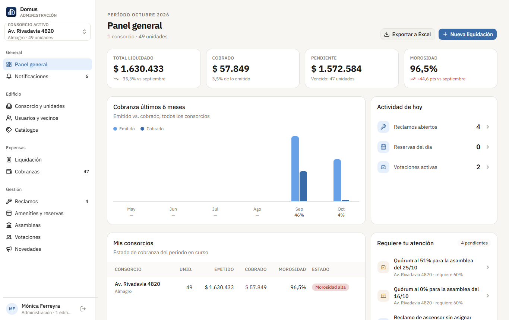

## 6. Guías del superadministrador

### 6.1 Cómo dar de alta un consorcio y su administrador

1. En el panel de la **Plataforma**, tocá **Nuevo consorcio** y cargá su domicilio, día de vencimiento, tasa de mora y fondo de reserva.
2. Asignale un administrador existente, o creá uno nuevo desde el mismo formulario.
3. El administrador ya lo ve en su selector de consorcios.

### 6.2 Cómo dar de baja o reactivar un consorcio

1. Abrí el consorcio y tocá editar.
2. Apagá el interruptor **Activo**. En el listado aparece como inactivo.
3. Para reactivarlo, volvé a encender el interruptor.

Para operar un consorcio como administrador, usá **Administrar consorcios** en el menú lateral.

## 7. Estados y qué significan

**Boleta**

| Estado | Qué significa |
|---|---|
| Pendiente | Emitida, sin pagos y todavía no venció. |
| Parcial | Tiene algún pago, pero queda saldo. |
| Vencida | Pasó el vencimiento con saldo; suma intereses en la boleta siguiente. |
| Pagada | El saldo está cubierto. |

**Reclamo**

| Estado | Qué significa |
|---|---|
| Nuevo | Recién abierto, nadie lo tomó todavía. |
| En curso | La administración lo está trabajando. |
| Esperando proveedor | Tiene un proveedor asignado y se espera su visita. |
| Resuelto | Cerrado. Se puede reabrir si el problema sigue. |

**Reserva**

| Estado | Qué significa |
|---|---|
| Pendiente | Espera la aprobación de la administración. Ya ocupa el lugar. |
| Aprobada | Confirmada. |
| Rechazada | La administración no la aprobó, con un motivo. |
| Cancelada | La canceló el vecino o la administración. |
| Finalizada | Ya pasó. |

**Liquidación** (sólo administrador)

| Estado | Qué significa |
|---|---|
| Borrador | Se están cargando los gastos. |
| Previsualización | Las boletas están calculadas y se pueden revisar. |
| Emitida | Las boletas son deuda y los vecinos las ven. |
| Cerrada | El período terminó; las boletas siguen contando como deuda. |

## 8. Cómo funciona

### 8.1 Cómo se calcula tu boleta

Cada gasto del mes se reparte entre las unidades según su coeficiente: una unidad con coeficiente 2,5 paga el 2,5 % de cada gasto. A eso se le suma el fondo de reserva, que es un porcentaje de las expensas ordinarias. Si la boleta anterior quedó con saldo, ese saldo se suma con intereses por los días de atraso. El resultado se redondea al centavo de forma que la suma de todas las boletas coincida exactamente con el total de gastos.

### 8.2 Por qué sólo se paga la última boleta

Cada boleta nueva ya incluye lo que quedó sin pagar de la anterior, como saldo anterior. Si se pudiera pagar una boleta vieja, la misma deuda se cobraría dos veces. Por eso Domus sólo deja pagar la más reciente, y cuando queda pagada, las anteriores también se dan por pagadas.

## 9. Mensajes de error frecuentes y qué hacer

| Mensaje | Qué pasó | Qué hacer |
|---|---|---|
| (Sin mensaje) La app vuelve a la pantalla de ingreso | La sesión venció o se cerró desde otra pestaña. | Ingresá de nuevo. Lo que estabas cargando y no guardaste se pierde. |
| Email o contraseña incorrectos | Alguno de los dos datos no coincide, o la cuenta está dada de baja. | Revisá los datos. Si no recordás la contraseña, pedile a la administración que te asigne una nueva. |
| Demasiados intentos fallidos. Probá de nuevo en N minutos. | Hubo 5 intentos fallidos seguidos y la cuenta se bloqueó por seguridad. | Esperá el tiempo indicado. |
| Esta deuda ya está incluida en la boleta más reciente de la unidad: pagá esa | Intentaste pagar una boleta vieja. | Pagá la boleta más reciente desde Expensas. |
| (Amenity) se cancela hasta N horas antes. Pedíselo a la administración. | Pasó el plazo de cancelación del amenity. | Pedile a la administración que la cancele. |
| La subida de archivos no está configurada | El servidor no tiene configurado el almacenamiento de archivos. | Avisale al soporte de Domus. |
| Previsualizá las boletas antes de emitir | Se intentó emitir una liquidación en borrador. | Tocá Continuar a previsualización, revisá y después emití. |
| Cargá al menos un gasto antes de calcular las boletas | La liquidación no tiene gastos. | Agregá los gastos del mes. |
| Hay un período anterior sin emitir en este consorcio: emitilo primero | Quedó una liquidación anterior sin emitir. | Emití primero la del período anterior. |
| Los coeficientes del consorcio pasarían el 100 % | La unidad que cargás supera el total disponible. | Revisá los coeficientes de las unidades. |
| La unidad ya tiene un titular | Se intentó cargar un segundo titular. | Terminá el vínculo del titular actual o cargá al vecino sin marcarlo como titular. |
| Indicá el motivo del ajuste: el vecino lo ve en su boleta | Se cargó un ajuste sin motivo. | Escribí el motivo. |

## 10. Preguntas frecuentes y soporte

**Pagué y la boleta sigue pendiente.** Si al terminar en Mercado Pago no tocaste Volver al sitio, el pago puede tardar en verse. Entrá a Expensas: si sigue pendiente, avisale a la administración con el número de operación de Mercado Pago.

**¿Puedo tener más de una unidad?** Sí. Si sos propietario o inquilino de varias, elegís cuál ver desde el menú de la barra superior, en **Tus unidades**.

**No me llegan los mails.** Revisá la carpeta de correo no deseado y tus preferencias de aviso en Perfil.

**Soporte:** escribile a la administración de tu edificio. Los administradores pueden contactar al equipo de Domus por el canal de la cátedra.
